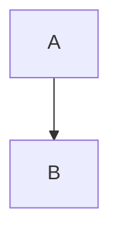

# Mermaid Diagrams

````markdown

````

```html
<markdown mermaid [src]="'diagrams.md'" />
```

Needs `node_modules/mermaid/dist/mermaid.min.js` as a global script. Without it, rendering throws
`errorMermaidNotLoaded`.

## How it works

1. While parsing, ```` ```mermaid ```` blocks become `<div class="mermaid">…</div>` instead of code.
2. After the HTML is in the DOM, the library calls `mermaid.initialize(config)` and then
   `mermaid.run({ nodes })` with the `.mermaid` elements. Browser only.

## Configuration

The config is merged in this order (last wins): `{ startOnLoad: false }`, then the component's `mermaidOptions` (or
the pipe's `mermaidOptions`). There is no app-wide Mermaid token in this release; 19.0.0 adds `MERMAID_OPTIONS`.

```typescript
import { MermaidAPI } from '@fsegurai/ngx-markdown';

readonly options: MermaidAPI.Config = {
  theme: MermaidAPI.Theme.Dark,
  securityLevel: MermaidAPI.SecurityLevel.Loose,
};
```

```html
<markdown mermaid [mermaidOptions]="options" [data]="text" />
```

`MermaidAPI` is a hand-written namespace: `Config` (top-level keys such as `theme`, `themeVariables`, `darkMode`,
`securityLevel`, `logLevel`, `fontFamily`), the enums `SecurityLevel`, `Theme` and `LogLevel`, `ThemeVariables`,
typed `FlowChartConfig`, `SequenceDiagramConfig` and `GanttConfig`, and `RunOptions`. Other diagram keys are typed
`any`. Keys missing from `Config` (for example `look`) do not type-check; see the
[Mermaid config reference](https://mermaid.js.org/config/schema-docs/config.html) for what Mermaid accepts.

## Changing the theme

`mermaid.initialize()` runs on every render with the merged config. To switch themes, bind a new `mermaidOptions`
object: any input change re-renders `data` and `src` content (`src` is fetched again). Projected content is
rendered once and does not pick up the change.
