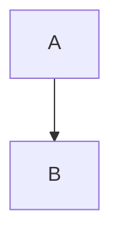

# Mermaid Diagrams

````markdown

````

```html
<markdown mermaid [src]="'diagrams.md'" />
```

Needs `node_modules/mermaid/dist/mermaid.min.js` as a global script. Without it, rendering throws
`ERROR_MERMAID_NOT_LOADED`.

## How it works

1. While parsing, ```` ```mermaid ```` blocks become `<div class="mermaid">…</div>` instead of code.
2. After the HTML is in the DOM, the library calls `mermaid.initialize(config)` and then
   `mermaid.run({ nodes })` with the `.mermaid` elements. Browser only.

## Configuration

The config is merged in this order (last wins): `{ startOnLoad: false }`, then `MERMAID_OPTIONS`, then the
component's `mermaidOptions`.

```typescript
provideMarkdown({
  mermaidOptions: { provide: MERMAID_OPTIONS, useValue: { darkMode: true, look: 'handDrawn' } },
});
```

```typescript
import { MermaidAPI } from '@fsegurai/ngx-markdown';

readonly options: MermaidAPI.MermaidConfig = { theme: 'dark', look: 'classic' };
```

```html
<markdown mermaid [mermaidOptions]="options" [data]="text" />
```

`MermaidAPI` is a namespace of Mermaid 11 config types (`MermaidConfig`, the per-diagram configs and `RunOptions`).
See the [Mermaid config reference](https://mermaid.js.org/config/schema-docs/config.html).

## Changing the theme

`mermaid.initialize()` runs on every render with the merged config. To switch themes, bind a new `mermaidOptions`
object: with `data` that re-renders automatically; with `src` or projected content, call
`MarkdownService.reload()` (projected content is not re-rendered by it).
